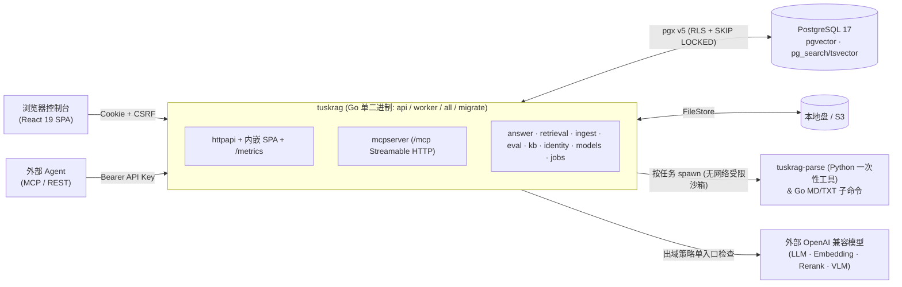

# TuskRAG

面向企业与 Agent 的**轻量知识检索与问答底座**：以**单个 PostgreSQL 17**（`pgvector` + `pg_search` / 兼容 `tsvector`）承载全部业务状态、全文检索、向量检索与任务队列；**Go 核心单二进制**承担 API、SSE、MCP、权限与检索编排并内嵌 React 控制台，**不加载任何模型权重**；文档解析由 **Python 解析工具**以一次性受限子进程完成。向控制台用户与外部 Agent（REST / MCP）提供**带权限、带引用、可评测**的知识检索与问答。

> **当前状态**：已完成 **M0—M5** 全部里程碑的功能实现与集成验证（数据库 Schema v35、A13 控制台布局与控件体系）。独立生产规格环境下的百万块/高并发压测（`V08`/`V09`/`T17`）、跨版本滚动升级（`V13`）及 `pg_search`（AGPL-3.0）法务最终评估仍待在对应环境与法务流程中完成。设计真源见 [文档地图](docs/README.md)，迭代记录与实测边界见 [.agents/NOTES.md](.agents/NOTES.md)。

---

## 核心设计原则

| 目标 | 工程手段 |
|---|---|
| **轻** | 仅 **2 个常驻服务**（`postgres` + `tuskrag`）；无 Elasticsearch、Redis、MinIO、MQ 或常驻 Python/JVM；解析在一次性子进程运行，用完即退；模型全外置。 |
| **快** | 单条 SQL 事务内完成 `access_tags` 预过滤 + BM25 ∥ halfvec HNSW + RRF 融合；仅对 Top-N 重排；默认单轮检索，复杂问题按需开启 Agentic 模式。 |
| **准** | 结构保真解析 + 页级质量门 + 按需 VLM；标题路径父子分块 + R07 上下文组装；交叉编码重排 + 引用强校验与拒答；离线检索评测与 E6 生成评测门禁。 |
| **企业级** | 租户强制 RLS + `force_custom_plan`；知识库 RBAC + 文档级 ACL + 出库实时复核（撤权即时生效）；OIDC PKCE SSO；范围化 API Key；审计日志；数据出域策略。 |

---

## 系统总体架构



更细粒度的模块关系与数据流图（支持直接在 GitHub 渲染）见 **[docs/架构图解.md](docs/架构图解.md)**：

| 架构图 | 覆盖内容 |
|---|---|
| [图 1：系统总体拓扑与进程角色](docs/架构图解.md#图-1系统总体拓扑与进程角色) | 2 个常驻进程、`api`/`worker`/`all`/`migrate` 角色边界、一次性解析沙箱与外部依赖 |
| [图 2：后端 Go 模块分层与依赖方向](docs/架构图解.md#图-2后端-go-模块分层与依赖方向) | `services/core/internal/` 各领域包职责与单向依赖约束 |
| [图 3：分层解析与原子入库流水线](docs/架构图解.md#图-3文档分层解析与原子入库流水线写路径) | 上传去重、租约认领、质量门、按需 VLM、父子分块、`is_current` 原子切换与清理 |
| [图 4：混合检索、问答与 Agentic / MCP 双读路径](docs/架构图解.md#图-4混合检索问答与-agentic--mcp-双读路径) | 单条 SQL 召回、重排、R07 上下文组装、SSE 引用校验、Agentic 6 步循环与 MCP 5 工具 |
| [图 5：企业权限、安全与数据出域纵深防御](docs/架构图解.md#图-5企业权限安全与数据出域纵深防御) | OIDC PKCE、API Key 配额/限速、RLS + `force_custom_plan` + 出库复核与出域策略 |

---

## 主要能力概览

- **文档解析与入库**：支持 Markdown、TXT、CSV、DOCX、PPTX、XLSX、HTML 与数字 PDF 原生解析，支持静态 URL 导入（SSRF 防护）与低分页按需 VLM 重解析；支持版本化重传原子切换、软删除与后台清理重试（`purge`）。
- **混合检索与上下文**：默认 `pg_search` BM25（可选 `tsvector` + Go `gse` 兼容驱动，自动检测回退）+ `pgvector` `halfvec` HNSW 迭代扫描 + RRF + 外部交叉编码重排；问答路径自动执行 R07 叶子节相邻合并、父节回溯与预算打包。
- **问答与 Agent 接入**：SSE 流式带引用问答（`grounded-v3`）、多轮追问改写（`rewrite-v1`）、证据不足拒答与反馈；支持显式 `mode=agentic`（`step` SSE 事件与步数/耗时/Token 截断）以及 `/mcp` Streamable HTTP（`search`、`list_documents`、`get_toc`、`read_section`、`get_neighbors`）。
- **企业治理与评测**：支持通用 OIDC SSO（PKCE + 组声明同步）、知识库 RBAC、用户组与文档级 ACL、范围化 API Key（RPM 限速 + 月度 Token 配额 + CIDR 白名单）、审计检索导出、模型提供方连通性探测，以及检索评测与 E6 生成评测对比。
- **部署与运维**：提供 `lite`、`standard`、`model-node`、`legacy-office` Compose 编排档位、Prometheus `/metrics`、以及 `tuskrag ops diagnose / rotate-master-key / reindex / verify-storage` 运维命令。

---

## 仓库结构

```text
TuskRAG/
├── apps/web/                 # React 19 + Vite + TanStack Router 控制台
├── packages/
│   ├── ui/                   # shadcn/ui + Radix 共享组件与 Tailwind v4 主题
│   ├── api-client/           # 基于 OpenAPI 生成的类型与 API 客户端
│   └── config/               # 共享 TypeScript / Biome 配置
├── contracts/                # openapi.json、parsed-document.schema.json、mcp-tools.json
├── services/
│   ├── core/                 # Go 核心服务 (cmd/tuskrag, internal/*, migrations, queries)
│   └── parser/               # Python 一次性解析工具 tuskrag-parse (uv 管理)
├── deploy/                   # Dockerfile、PG 17 镜像、Compose 档位、Linux 运维脚本与许可清单
├── tests/                    # Playwright E2E、评测集 (tests/eval/) 与进程隔离测试
└── docs/                     # 设计方案、架构图解、评测报告与验收记录
```

---

## 开发、构建与部署

### 环境要求

- Go `1.27+`、Python `3.13` + `uv`、Node.js `22.x` + `pnpm 10.15`
- PostgreSQL 17（含 `pgvector >= 0.8`，默认含 `pg_search`；初始化见 [deploy/postgres/README.md](deploy/postgres/README.md)）

### 常用命令

```bash
# 1. 安装前端与 Python 解析器依赖
pnpm install
cd services/parser && uv sync --locked --group dev && cd ../..

# 2. 构建前端并编译 Go 单二进制（产物输出至 dist/tuskrag 或 dist/tuskrag.exe）
pnpm build

# 3. 运行静态检查与基础测试（含 lint、typecheck、vitest、go vet/test、ruff/mypy/pytest）
pnpm check

# 4. 仅运行前端类型检查、单元测试与 UI 控件复用率检查
pnpm typecheck && pnpm test:web && node scripts/ui-reuse.mjs
```

### 容器化与生产部署

详细环境变量、迁移步骤、备份恢复及 Prometheus 告警规则请参阅 **[deploy/README.md](deploy/README.md)** 与 **[09 部署运维与可观测](docs/09-部署运维与可观测.md)**：

- **单机轻量档位（Lite）**：`deploy/compose/docker-compose.lite.yml`（`postgres` + `tuskrag role=all`）
- **标准分离档位（Standard）**：`deploy/compose/docker-compose.standard.yml`（`postgres` + `migrate` + `api` + `worker`）
- **离线模型节点 / 旧版 Office 叠加**：`docker-compose.model-node.yml`、`docker-compose.legacy-office.yml`
