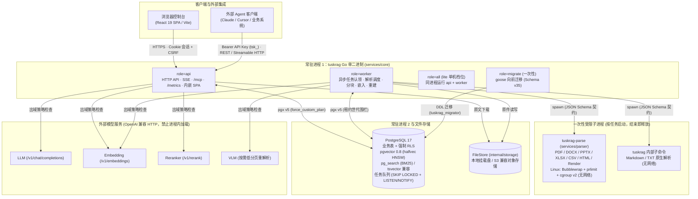
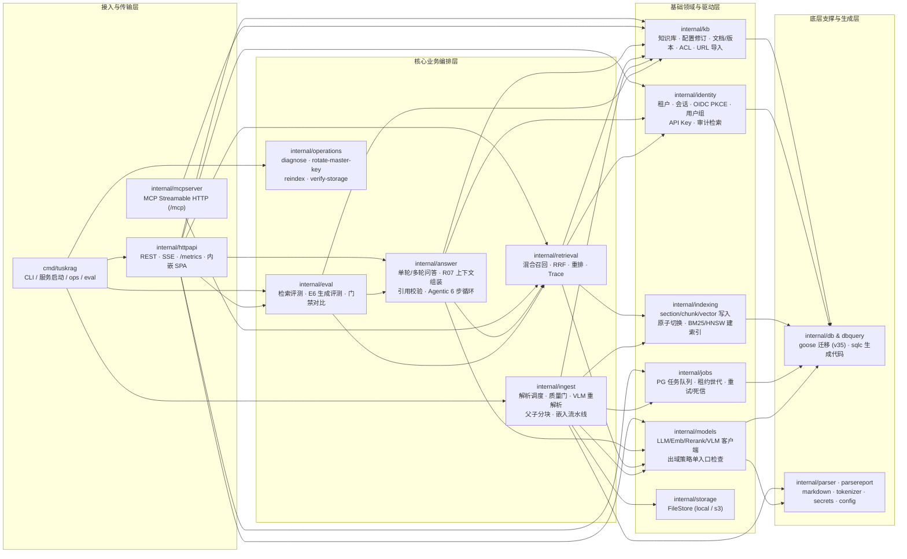
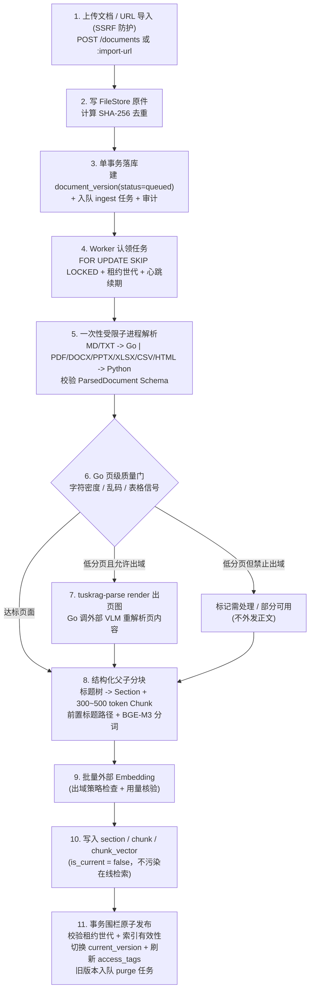
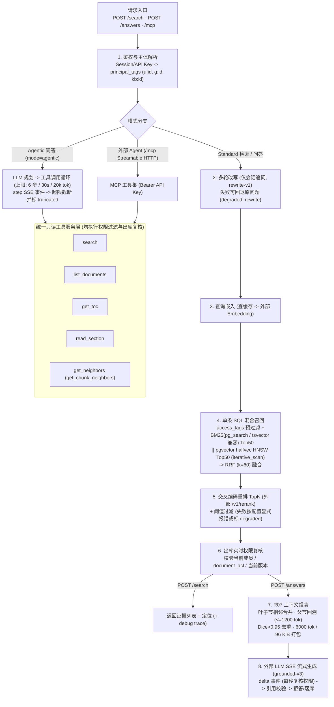

# TuskRAG 架构图解与模块标记

本文档将 TuskRAG 的总体拓扑、Go/Python 模块划分、入库写路径、检索/问答/Agentic/MCP 读路径及企业权限安全边界整理为 5 张分主题架构图（均使用 Mermaid 绘制，可在 GitHub 及主流 Markdown 阅读器中直接渲染），并与实际代码目录一一对应。

---

## 图 1：系统总体拓扑与进程角色

TuskRAG 的核心原则是**“2 个常驻进程 + 一次性受限解析子进程 + 外置模型”**（见 [A01](11-架构决策记录.md#a01)、[A02](11-架构决策记录.md#a02)、[A05](11-架构决策记录.md#a05)）。

**关键标记**：
- **常驻服务仅 2 个**：`tuskrag`（Go 单二进制，支持 `api` / `worker` / `all` / `migrate` 四种角色）与 `PostgreSQL 17`；无 Redis、Elasticsearch、MinIO、MQ 或常驻 Python 服务。
- **跨语言唯一契约**：Go `worker` 与 Python `tuskrag-parse` 之间通过 [parsed-document.schema.json](../contracts/parsed-document.schema.json) 传递结构化文档，无数据库或网络共享。
- **部署编排**：对应 `deploy/compose/` 下的 `lite`、`standard`、`model-node`、`legacy-office` 四个档位。

---

## 图 2：后端 Go 模块分层与依赖方向

代码位于 [services/core/internal](../services/core/internal)，通过单向依赖与 `golangci-lint`（`depguard`）约束层边界（见 [架构规则](../.agents/rules/architecture.md)）。

**关键标记**：
- **接口与契约生成**：`internal/httpapi` 基于 `huma v2` 导出 [openapi.json](../contracts/openapi.json)，再生成前端 [packages/api-client](../packages/api-client)；MCP 工具定义位于 [mcp-tools.json](../contracts/mcp-tools.json)。
- **前端工程**：控制台位于 [apps/web](../apps/web)，共用 [packages/ui](../packages/ui) 组件库，构建后通过 `go:embed` 打入二进制 `internal/httpapi/web`。

---

## 图 3：文档分层解析与原子入库流水线（写路径）

对应需求 `R02`–`R05`、`R16`、`R20`、`R21` 与决策 `A06`–`A08`、`A12`、`A15`。

**关键标记**：
- **故障隔离**：解析崩溃或内存溢出仅影响一次性子进程；长计算（解析、VLM、Embedding）不持有数据库事务；若 `worker` 在发布前崩溃，新 `worker` 认领后旧世代的迟到提交会被事务围栏拒绝（`V02`）。
- **版本原子性**：处理新版本期间，`is_current = true` 的旧版本持续正常服务，直到第 11 步单事务切换完成后新版本才可见（`T04`）。

---

## 图 4：混合检索、问答与 Agentic / MCP 双读路径

对应需求 `R06`–`R10`、`A09`、`A10`、`A14`；读路径全部在 Go 进程内完成，不经过 Python。

**关键标记**：
- **双 Lexical 驱动（`A03`）**：默认 `pg_search`（ParadeDB Jieba BM25）；托管 PG 或需规避 AGPL 时，自动切换/配置为 Go `gse` 应用侧分词 + `tsvector('simple')` GIN 兼容驱动，通过同一 `LexicalDriver` 接口与契约测试。
- **引用强校验**：生成结束后解析 `[n]`，移除无效编号；无有效引用且非拒答的回答显式标记 `unsupported`，无证据或不足时拒答（`T07`）。

---

## 图 5：企业权限、安全与数据出域纵深防御

对应需求 `R12`–`R16`、`R21` 与决策 `A11`、`A16`。

```mermaid
flowchart LR
    subgraph IdentityLayer["1. 身份与边界控制 (internal/identity)"]
        Local["本地账号 (argon2id + HttpOnly Cookie + CSRF)<br/>支持 disable_local_login 应急开关"]
        OIDC["通用 OIDC SSO (Authorization Code + PKCE S256)<br/>JWKS 验签 + group_claim 自动同步用户组"]
        APIKey["API Key (tsk_前缀 + SHA-256 哈希)<br/>KB/动作范围 · CIDR 白名单 · RPM 限速 · 月度 Token 配额"]
    end

    subgraph DBLayer["2. 数据库与检索隔离 (PG 17 + internal/kb)"]
        RLS["强制 RLS (FORCE ROW LEVEL SECURITY)<br/>所有核心表按 tuskrag.tenant_id 隔离<br/>应用角色 tuskrag_app 无 DDL/BYPASSRLS 权限"]
        Plan["force_custom_plan 连接约束<br/>防止 pg_search 通用计划跨租户缓存泄露"]
        ACL["知识库 RBAC (owner/admin/editor/viewer)<br/>+ 文档级 ACL (inherit_kb / restricted)<br/>召回预过滤 (access_tags) + 出库实时复核 (撤权即时生效)"]
    end

    subgraph EgressLayer["3. 数据出域与密钥安全 (internal/models & secrets)"]
        Egress["单入口出域检查<br/>租户 egress_policy_max >= 知识库 egress_policy<br/>(deny / internal_only / allow) vs 提供方 locality"]
        Vault["密钥加密存储<br/>model_provider / oidc_provider 凭据密文落库<br/>支持 ops rotate-master-key 单事务轮换"]
        Audit["追加写审计日志 (audit_log)<br/>记录管理操作、检索、下载与导出，不记录正文与完整 Prompt"]
    end

    IdentityLayer --> DBLayer --> EgressLayer
```

**关键标记**：
- **越权证据数为 0**：通过“租户 RLS + `force_custom_plan` + 召回 `access_tags` 预过滤 + 出库事务实时复核（含流式生成每秒复核）”四重防线保证撤权即时生效（`T08`–`T10`）。
- **出域可控**：所有对 LLM、Embedding、Reranker、VLM 的调用均经 `internal/models` 单入口校验知识库与租户出域策略，禁止违规外发正文。
